# Panduan Arsitektur & Integrasi: Library Publik `agentrunner`

Dokumen ini mendokumentasikan inisiatif ekstraksi modul matang Cuan menjadi pustaka Go publik independen [**`github.com/buchin/agentrunner`**](https://github.com/buchin/agentrunner) berlisensi MIT.

---

## 1. Latar Belakang & Rationale

Sebelum ekstraksi, seluruh logika pengawasan proses (*process supervision*), manajemen lock file, isolasi ruang kerja git (*workspace isolation*), pembunuhan pohon proses (*process tree termination*), pemantauan memori RSS (*resource monitoring*), penyuntingan rahasia (*secret masking*), dan penghitungan timeout adaptif tersebar di dalam paket internal Cuan (`internal/taskprocess`, `internal/agent`, `internal/git`, `internal/runner`).

Kondisi tersebut menyebabkan:
1. **Pemborosan Konteks Token AI**: Agen AI yang mengerjakan tugas-tugas berikutnya harus membaca ratusan baris kode supervisor berulang kali.
2. **Risiko Regresi**: Modifikasi pada file internal dapat secara tidak sengaja memengaruhi kestabilan eksekusi proses agen.

Dengan mengekstraksi modul-modul ini ke pustaka independen `github.com/buchin/agentrunner`:
- Ukuran kode internal Cuan menyusut drastis (*lean & clean architecture*).
- Konteks token AI saat pengerjaan tugas berikutnya berkurang secara signifikan.
- Logika runner dan supervisor terlindungi dari regresi karena memiliki siklus rilis semantik (*semantic release*) dan unit test mandiri yang teruji 100% PASS dalam waktu <1 detik.

---

## 2. Empat Pilar Utama `agentrunner`

```mermaid
flowchart TD
    A["github.com/buchin/agentrunner"] --> B["1. Process Supervisor & OS Lock"]
    A --> C["2. CLI Agent Executor & Process Tree"]
    A --> D["3. Task Workspace Isolation & Git Guardrails"]
    A --> E["4. Progressive Adaptive Timeout"]

    B --> B1["flock Exclusive Locks (Acquire/Active)"]
    B --> B2["Parent-Death Tracking (Pdeathsig & Polling)"]
    B --> B3["CPU Priority Demotion (nice 19)"]
    B --> B4["Resource Guardrails (GOMEMLIMIT, GOMAXPROCS)"]

    C --> C1["Process Group Isolation (Setpgid)"]
    C --> C2["Recursive Process Tree Killer"]
    C --> C3["RSS Memory Monitor (/proc/pid/statm)"]
    C --> C4["Credential Redactor (MaskSecrets)"]

    D --> D1["Local & Remote Git Clone / Task Branch"]
    D --> D2["Human Git Author Configuration"]
    D --> D3["Pre-Push Hook Default Branch Protection"]

    E --> E1["Attempt 1: 25m Base Timeout"]
    E --> E2["Attempt 2: 35m Requeue Timeout"]
    E --> E3["Attempt 3+: 45m Hard Cap Timeout"]
    E --> E4["Two-Stage Graceful SIGTERM -> SIGKILL"]
```



### 2.1. Process Supervisor (`agentrunner.Supervisor`)
- **OS-backed Exclusive Lock**: Menggunakan `syscall.Flock` dengan flag non-blocking (`LOCK_EX|LOCK_NB`). Mengembalikan `ErrActive` jika task sedang dijalankan proses lain.
- **Parent Death Detection**: Mengikat sinyal kematian proses induk melalui Linux `Pdeathsig: syscall.SIGKILL` dan ticker polling berkala (`os.Getppid() != initialParent`).
- **Resource Guardrails**: Menyuntikkan limit memori dan CPU default (`GOMEMLIMIT=400MiB`, `GOMAXPROCS=1`, `GOGC=50`, `NODE_OPTIONS=--max-old-space-size=512`).
- **Background Nice Demotion**: Menurunkan prioritas proses ke `nice 19` agar eksekusi agen tidak mengganggu performa server HTTP atau basis data.
- **PTY Terminal Handoff**: Mengalihkan controlling terminal ke process group agen via `unix.TIOCSPGRP`.

### 2.2. CLI Agent Executor & Process Tree Management
- **CLI Adapter**: Interface `Adapter` dan struct `CLIAdapter` untuk menjalankan agent CLI (`agy`, `claude`, shell).
- **Process Group Isolation**: Spawning proses dengan `Setpgid: true` sehingga seluruh sub-proses berada dalam PGID terisolasi.
- **KillProcessTree**: Menemukan PID anak melalui `/proc/<pid>/task/<pid>/children` dan menghentikan seluruh pohon proses secara bersih.
- **Resource Monitor**: `ProcessMonitor` mengukur pemakaian memori riil (*Resident Set Size*) dari `/proc/<pid>/statm`.
- **Secret Redactor**: `MaskSecrets` mendeteksi dan menyunting token GitHub PAT, JWT/Bearer, koneksi PostgreSQL, dan API keys.

### 2.3. Task Workspace Isolation
- **PrepareTaskWorkspace**: Menyiapkan clone lokal dari repo dasar secara kilat (*shared object store*).
- **Branch Isolation**: Otomatis membuat dan beralih ke branch tugas (`task/<task_id>`).
- **Identitas Git**: Mengonfigurasi `user.name` dan `user.email` anggota tim.
- **Pre-Push Branch Protection**: Menginstal pre-push hook yang memblokir percobaan push langsung ke branch utama (`main`/`master`).

### 2.4. Progressive Adaptive Timeout
- Attempt 1: 25 menit (waktu komputasi standar).
- Attempt 2: 35 menit (kompensasi penyesuaian/requeue).
- Attempt 3+: 45 menit (batas atas absolut).
- Grace period 30 detik untuk terminasi bertahap: pengiriman `SIGTERM`, lalu eskalasi tegas ke `SIGKILL`.

---

## 3. Integrasi dalam Cuan

Repositori Cuan mengonsumsi library ini secara resmi melalui Go Module:
```bash
go get github.com/buchin/agentrunner
```

File-file Cuan yang mengintegrasikan `agentrunner`:
1. `internal/taskprocess/supervisor.go`: Mengarahkan fungsi `Acquire`, `Active`, `OpenLock`, dan `Run` ke `agentrunner`.
2. `internal/agent/process_tree.go`: Mengarahkan `KillProcessTree`, `GetChildPIDs`, `IsProcessAlive` ke `agentrunner`.
3. `internal/agent/resource_monitor.go`: Mengarahkan `ProcessMonitor` dan `readRSS` ke `agentrunner`.
4. `internal/agent/secret_masker.go`: Mengarahkan `MaskSecrets` dan `SanitizeEnv` ke `agentrunner`.
5. `internal/runner/timeout.go`: Mengarahkan perhitungan timeout adaptif ke `agentrunner`.
6. `internal/git/workspace.go`: Mengarahkan persiapan workspace, konfigurasi identitas git, dan branch protection ke `agentrunner`.

---

## 4. Bukti Verifikasi Pengujian

| Komponen | Paket Pengujian | Durasi | Status |
|---|---|---|---|
| Library Mandiri `agentrunner` | `github.com/buchin/agentrunner` | **0.37s** | **100% PASS** |
| Taskprocess Supervisor | `github.com/buchin/cuan/internal/taskprocess` | **0.73s** | **100% PASS** |
| Task Runner & Timeout | `github.com/buchin/cuan/internal/runner` | **0.21s** | **100% PASS** |
| Git Workspace & Protection | `github.com/buchin/cuan/internal/git` | **3.04s** | **100% PASS** |
| Agent Execution & Tree | `github.com/buchin/cuan/internal/agent` | **0.41s** | **100% PASS** |
| Terminal Manager | `github.com/buchin/cuan/internal/terminal` | **1.35s** | **100% PASS** |
| Frontend Test Suite | `npm test --prefix web` (272 tests) | **4.68s** | **100% PASS** |
| Build Kompilasi Web | `npm run build --prefix web` | **12.98s** | **0 Error** |
| Kompilasi Binary Backend | `go build ./cmd/server && go build ./cmd/runner` | **Kilat** | **0 Error** |
