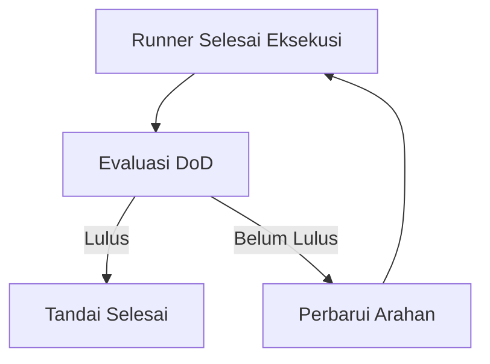

# Integrasi Diagram Mermaid pada Chat & Markdown Cuan

## Gambaran Umum (Overview)

Cuan kini mendukung perenderan visual interaktif untuk diagram alur dan arsitektur menggunakan pustaka **Mermaid.js** langsung di dalam gelembung obrolan (*chat bubbles*), *MarkdownViewer*, dan *FilePreviewModal*.

Blok kode bertanda ` ```mermaid ` atau ` ```flowchart ` secara otomatis diubah menjadi grafik vektor skalar visual (SVG) resolusi tinggi dan tidak lagi ditampilkan sebagai teks mentah atau accordion tertutup.

---

## Fitur Utama

### 1. Rendering Otomatis Bersih & Anggun
- Sintaks Mermaid diproses secara modular dan asinkron.
- Mengadopsi standar **Calm Design** (Things 3 & Bear Notes) dengan batas hairline lembut, latar belakang mikrotint netral, dan tipografi Geist yang tajam.
- Mendukung tema Light Mode dan Dark Mode secara otomatis.

### 2. Responsif Mobile Viewport (360px–390px)
- **Anti-Overflow**: Menerapkan `max-width: 100%` dan `height: auto` pada diagram SVG sehingga tidak pernah memecah atau merusak layout obrolan pada layar kecil.
- **Touch Momentum Scrolling**: Wadah diagram menerapkan `overflow-x: auto`, `-webkit-overflow-scrolling: touch`, dan `touch-action: pan-x pan-y`, memungkinkan pengguna menggeser diagram lebar secara mulus dengan sentuhan jari.

### 3. Viewer Interaktif & Zoom/Pan Pop-up
- Tombol **Perbesar** pada toolbar membuka modal viewer layar penuh (*fullscreen / pop-up viewer*).
- Dilengkapi kontrol zoom presisi:
  - **Zoom In (+20%)** hingga 300%
  - **Zoom Out (-20%)** hingga 40%
  - **Reset (100%)** untuk mengembalikan posisi awal
- Kanvas geser (*pan & drag*) interaktif untuk navigasi diagram kompleks.
- Tab pengalih **Visual** vs **Sintaks** untuk melihat kode asli.
- Tombol **Salin** satu klik untuk menyalin kode sintaks Mermaid ke clipboard.
- Dukungan tombol `Esc` dan tombol tutup ergonomis dengan target sentuh ≥44px.

### 4. Graceful Fallback (Ketahanan Galat)
- Jika sintaks Mermaid yang dihasilkan agen atau pengguna rusak/salah (misal kurung tidak tertutup atau token asing), sistem menangani kesalahan secara graceful tanpa crash.
- Menampilkan badge galat yang rapi: `Sintaks diagram Mermaid tidak valid`.
- Menyajikan fallback teks mentah terformat yang aman dengan tombol salin, sehingga percakapan tetap berjalan normal.

---

## Contoh Penggunaan Sintaks


