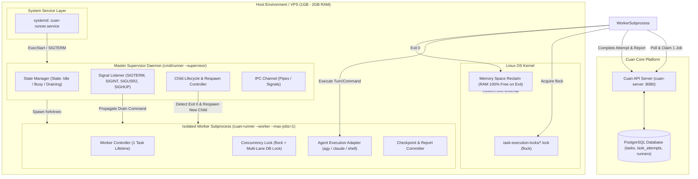
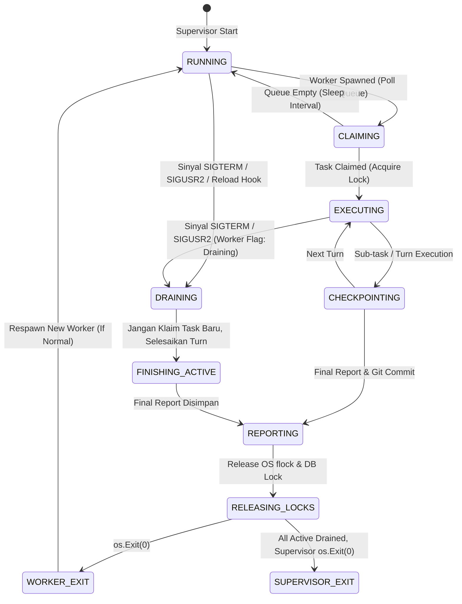
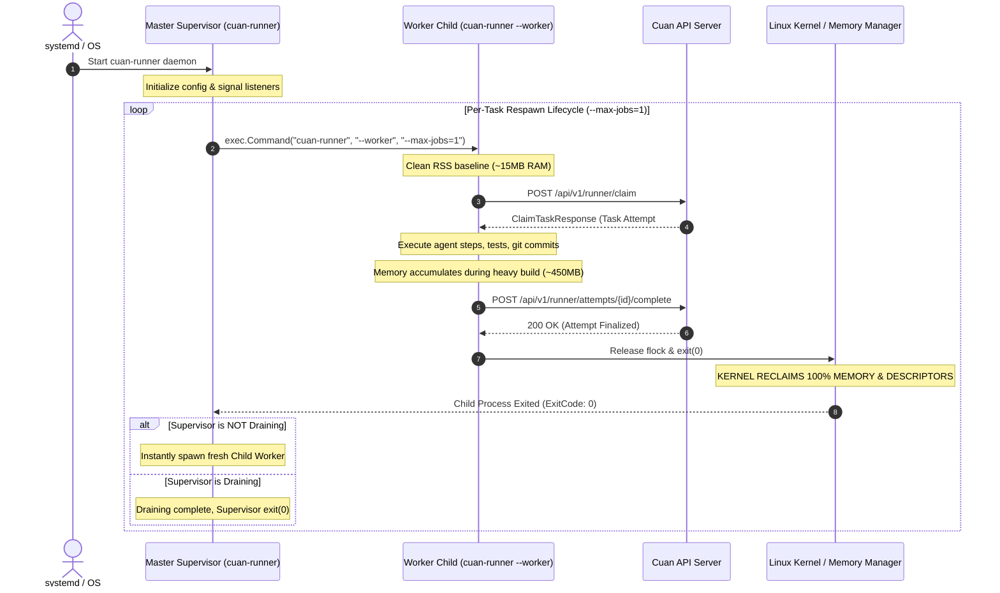

# Blueprint Arsitektur Runner: Graceful Worker & Lifecycle ala Laravel

## Otorisasi & Scope Digest
- **Scope Digest**: `a2c5f506d0097239094751314e1fa687c033f3bcbbc42fd27b8933d2955053fe`
- **Approval Message**: `8ec1aa38-73c7-4755-9c87-32237e265e9d`
- **User Authorization**: Gas
- **Conversation ID**: `7def4979-e4e4-41d5-aef1-026bceed2805`
- **Target Repository**: Cuan (`cuan`)
- **Tujuan Utama**: Merancang cetak biru arsitektur (*technical blueprint*) dan spesifikasi teknis implementasi untuk mengadopsi pola *graceful daemon worker* (ala Laravel Queue Worker / Laravel Horizon) ke runner terminal agent Cuan. Fokus pada dua kemampuan krusial:
  1. **Graceful Draining & Signal Handling**: Menghindari pemutusan paksa task saat reload/deployment platform dengan membiarkan checkpoint aktif selesai dan melepaskan concurrency lock secara bersih.
  2. **Siklus Respawn Per-Task (Zero Memory Leak)**: Mengisolasi eksekusi per task dalam sub-proses dengan siklus exit & respawn (`--max-jobs=1`) demi stabilitas VPS dengan RAM terbatas.

---

## 1. Analisis Kesenjangan & Evaluasi Arsitektur Saat Ini

### 1.1 Kondisi Runner Cuan Saat Ini (`internal/runner` & `cmd/runner`)
Pada implementasi runner saat ini:
1. **Model Proses Monolitik Tunggal**:
   - Daemon [`cmd/runner/main.go`](file:///opt/cuan/data/projects/task-workspaces/222278de015663e5fae4d4264c238d670aabcba6db621a2bf7c32d71674126c0/cmd/runner/main.go) berjalan sebagai satu proses Go tunggal yang hidup terus menerus (*long-running process*).
   - Ketika ada task antrean yang diklaim di [`pollAndExecute`](file:///opt/cuan/data/projects/task-workspaces/222278de015663e5fae4d4264c238d670aabcba6db621a2bf7c32d71674126c0/internal/runner/runner.go#L164-L280), runner menjalankan `go func(...)` goroutine di dalam proses daemon yang sama.
2. **Signal Handling Merusak (Abrupt Termination)**:
   - Pada [`cmd/runner/main.go#L78-L82`](file:///opt/cuan/data/projects/task-workspaces/222278de015663e5fae4d4264c238d670aabcba6db621a2bf7c32d71674126c0/cmd/runner/main.go#L78-L82):
     ```go
     go func() {
         sig := <-shutdown
         log.Printf("Received signal %v, terminating runner...", sig)
         cancel() // Segera membatalkan root context
     }()
     ```
   - Pembatalan `cancel()` langsung memicu [`r.cancelCurrentExecution()`](file:///opt/cuan/data/projects/task-workspaces/222278de015663e5fae4d4264c238d670aabcba6db621a2bf7c32d71674126c0/internal/runner/runner.go#L98) yang memanggil `cancelFunc()` untuk seluruh task aktif yang sedang berjalan.
   - Dampaknya: di [`runner.go#L382-L386`](file:///opt/cuan/data/projects/task-workspaces/222278de015663e5fae4d4264c238d670aabcba6db621a2bf7c32d71674126c0/internal/runner/runner.go#L382-L386), task yang sedang melakukan kompilasi, verifikasi test, atau git commit langsung dihentikan paksa dengan status `canceled` (exit code 130).
3. **Akumulasi Memori & RSS Creep pada VPS Terbatas**:
   - Eksekusi AI Coding Agent melibatkan ribuan baris log ANSI I/O, subprocess (`agy`, Node.js CLI, git CLI, Go compiler), diff buffer besar, dan caching memori.
   - Meskipun Go memiliki Garbage Collector, memori heap yang telah terfragmentasi pada sistem operasi Linux sering kali tidak langsung dikembalikan ke OS (*glibc/madvise retention*). Akibatnya, pada VPS dengan RAM 1 GB – 2 GB, akumulasi RSS menyebabkan daemon terkena *OOM Killer (Out Of Memory)* secara mendadak.
4. **Perilaku Deployment Platform Saat Ini**:
   - Skrip deployment [`scripts/activate-release.py`](file:///opt/cuan/data/projects/task-workspaces/222278de015663e5fae4d4264c238d670aabcba6db621a2bf7c32d71674126c0/scripts/activate-release.py#L48-L58) memanggil `systemctl restart cuan`.
   - Method [`server.PrepareGracefulShutdown`](file:///opt/cuan/data/projects/task-workspaces/222278de015663e5fae4d4264c238d670aabcba6db621a2bf7c32d71674126c0/internal/server/server.go#L615-L627) hanya memberi jeda 200 ms sebelum memanggil `CloseAll()` yang membunuh sesi PTY secara mendadak.

### 1.2 Inspirasi Pola Graceful Worker & Lifecycle ala Laravel / Horizon
Di ekosistem Laravel Queue & Horizon:
- **`php artisan queue:work --max-jobs=1`**:
  - Worker mengambil 1 job, mengeksekusi sampai selesai, dan keluar (`exit 0`).
  - Supervisor (systemd / Horizon Master) langsung menyalakan sub-proses worker baru.
  - **Efek Zero Memory Leak**: Kernel OS membersihkan 100% address space virtual memory dan file descriptors saat proses mati.
- **Signal Handling & Graceful Draining**:
  - Saat deployment (`php artisan queue:restart` atau `SIGTERM` dari systemd):
  - Worker menandai flag internal `shouldQuit = true`.
  - Worker **berhenti mengambil job baru** dari queue (*pause intake*).
  - Worker **tetap menyelesaikan job yang sedang aktif** hingga selesai, melepaskan atomic concurrency lock, dan keluar secara bersih.
  - Hanya jika job melebihi batas waktu toleransi (*grace timeout*), barulah supervisor mematikan proses via `SIGKILL`.

### 1.3 Tabel Komparasi: Arsitektur Eksisting vs Target Spesifikasi

| Aspek | Arsitektur Saat Ini | Target Arsitektur Baru (ala Laravel) |
|---|---|---|
| **Pola Proses** | Single Monolithic Daemon (Goroutine-based per task) | Master Supervisor Daemon + Isolated Worker Subprocess |
| **Siklus Hidup Proses** | Daemon hidup terus menerus (*indefinite*) | Siklus Respawn Per-Task (`--max-jobs=1`) |
| **Manajemen Memori** | Mengandalkan Go GC (rentan memory fragmentation & RSS creep di VPS kecil) | **Zero Memory Leak Guarantee**: OS kernel membersihkan 100% RAM saat child worker `exit(0)` |
| **Respon terhadap `SIGTERM`** | Membatalkan context seketika, task gagal `canceled` (Exit 130) | **Graceful Draining**: Berhenti polling task baru, tunggu task aktif selesai/checkpoint |
| **Pelepasan Concurrency Lock** | Rentan orphan lock jika daemon dimatikan mendadak | Terjamin melalui deferred clean-up di tingkat OS (`flock`) dan DB update |
| **Perilaku Deployment** | Restart memutus sesi task yang sedang berjalan | Zero-downtime deployment: reload hook memicu drain lalu restart mulus |
| **Batas Toleransi Shutdown** | 200 ms (terlalu singkat untuk AI agent / build) | Terkonfigurasi via `CUAN_RUNNER_DRAIN_TIMEOUT` (default: 60s - 120s) |

---

## 2. Blueprint Arsitektur: Dual-Process Supervisor & Worker Model

### 2.1 Diagram Arsitektur & Relasi Komponen



---

## 3. Spesifikasi Teknis Pilar 1: Mekanisme Graceful Draining & Signal Handling

### 3.1 State Machine Transisi Runner



### 3.2 Detail Alur Graceful Draining pada Sinyal `SIGTERM` / `SIGUSR2`
1. **Penerimaan Sinyal**:
   - Master Supervisor menangkap sinyal `SIGTERM` (dari `systemctl stop/restart` atau skrip deploy) atau `SIGUSR2` (reload hook).
   - Supervisor mengubah status internal menjadi `draining = true`.
   - Supervisor mengirimkan sinyal graceful drain ke Worker Subprocess (melalui IPC command atau sinyal POSIX `SIGUSR1`).
2. **Reaksi Worker Subprocess**:
   - Jika Worker sedang dalam status **IDLE / CLAIMING**: Worker segera membatalkan polling dan langsung keluar dengan kode `0`.
   - Jika Worker sedang dalam status **EXECUTING** (sedang menjalankan attempt):
     - Worker **TIDAK mematikan child process secara tiba-tiba**.
     - Worker membiarkan agent menyelesaikan instruksi atau checkpoint langkah aktif yang sedang berjalan.
     - Worker menghentikan loop perulangan turn baru.
     - Worker mengirimkan laporan ke API server via `CompleteAttemptRequest` atau mencatat status checkpoint terakhir.
     - Worker melepaskan *concurrency lock*:
       - Menutup file descriptor OS `flock` pada `/opt/cuan/data/workspaces/.task-execution-locks/<task_id>.lock`.
       - Mengirimkan update ke tabel `task_launches` (`state = 'stopped'`) dan `task_attempts`.
       - Melepaskan multi-lane mutex (`gitDeployMu`, `opsMu`, `readersMu`).
     - Worker melakukan `os.Exit(0)`.
3. **Grace Drain Timeout & Hard Kill Escalate**:
   - Supervisor menetapkan deadline toleransi drain via `CUAN_RUNNER_DRAIN_TIMEOUT` (default: 60 detik, dapat dikonfigurasi hingga 300 detik untuk task kompilasi berat).
   - Jika worker child tidak kunjung selesai setelah batas waktu tersebut:
     - **Tahap 1**: Supervisor mengirimkan `SIGTERM` ke process group worker (`-worker.Pid`).
     - **Tahap 2**: Diberi grace period tambahan 10 detik.
     - **Tahap 3**: Jika proses masih terkunci, dikirimkan `SIGKILL` (`-worker.Pid`).
     - Supervisor membersihkan residual lock files sebelum keluar.
4. **Clean Exit Supervisor**:
   - Setelah worker keluar dan tidak ada child process yang tersisa, Supervisor keluar secara bersih dengan kode `0`.

---

## 4. Spesifikasi Teknis Pilar 2: Siklus Respawn Per-Task (Zero Memory Leak)

### 4.1 Mengapa Pola `--max-jobs=1` Vital untuk VPS Cuan
1. **Karakteristik Workload Agent**:
   - Sesi terminal AI agent mengonsumsi memori besar: Go compiler (`go test`), Vite build, `git status/diff`, buffer ANSI terminal puluhan ribu baris, runtime Node.js, dan komunikasi JSON RPC berukuran megabyte.
2. **Keterbatasan Runtime Garbage Collector di Linux**:
   - Alokasi memori heap Go dan pustaka C yang dipanggil via syscall/cgo sering mengalami fragmentasi halaman memori (*heap fragmentation*). OS Linux tidak serta merta menarik kembali halaman fisik RAM (*Resident Set Size - RSS*) yang telah terfragmentasi.
   - Pada daemon yang berjalan tanpa henti, memori RSS terus meningkat (*RSS creep*) dari 40 MB menjadi 600 MB+ setelah puluhan task, hingga akhirnya memicu *Linux Out-Of-Memory (OOM) Killer* mematikan server.
3. **Mekanisme Zero Memory Leak Melalui Boundary Kernel OS**:
   - Dengan menjalankan eksekusi task di dalam proses worker terpisah (`cuan-runner worker --max-jobs=1`):
     - Setiap task mendapatkan ruang memori baru (*clean address space*).
     - Begitu task selesai dilaporkan: **Worker melakukan `os.Exit(0)`**.
     - **OS Kernel Linux secara otomatis dan seketika menarik 100% alokasi memori**: heap, stack, mapped files (`mmap`), file descriptor socket/pipe, dan process tracking kernel terhapus total.
     - Baseline memori server kembali ke kondisi murni (*idle baseline*) ~15 MB RAM.

### 4.2 Alur Sequence Diagram: Siklus Respawn Per-Task



---

## 5. Penyusunan Spesifikasi Teknis & Blueprint Transisi Codebase Cuan

Berikut adalah pemetaan perubahan arsitektur konkret pada berkas-berkas di repositori `cuan`:

### 5.1 Perubahan pada `cmd/runner/main.go`
Menambahkan dukungan dual-mode: mode Supervisor (default daemon) dan mode Worker (`--worker`).

```go
package main

import (
	"context"
	"flag"
	"fmt"
	"log"
	"os"

	"github.com/buchin/cuan/internal/agent"
	"github.com/buchin/cuan/internal/config"
	"github.com/buchin/cuan/internal/runner"
)

func main() {
	showHelp := flag.Bool("help", false, "Show help message")
	isWorker := flag.Bool("worker", false, "Run in worker sub-process mode (internal invocation)")
	maxJobs := flag.Int("max-jobs", 1, "Maximum number of jobs to execute before worker clean exit (default: 1)")
	drainTimeoutSec := flag.Int("drain-timeout", 90, "Graceful draining timeout in seconds on SIGTERM")
	agentBin := flag.String("agent-bin", "", "Custom path to agent binary")
	serverURL := flag.String("server-url", "", "Cuan server URL")
	runnerID := flag.String("runner-id", "", "Runner unique ID")
	runnerToken := flag.String("runner-token", "", "Runner authentication token")
	flag.Parse()

	if *showHelp {
		printRunnerHelp()
		os.Exit(0)
	}

	cfg := config.Load()
	if *serverURL != "" {
		cfg.RunnerServerURL = *serverURL
	}
	if *runnerID != "" {
		cfg.RunnerID = *runnerID
	}
	if *runnerToken != "" {
		cfg.RunnerToken = *runnerToken
	}

	// 1. Worker Mode: Dieksekusi oleh Supervisor untuk menjalankan N task (default 1) lalu exit(0)
	if *isWorker {
		adapter, err := agent.NewAGYAdapter(*agentBin)
		if err != nil {
			log.Fatalf("[Worker] Failed to initialize agent adapter: %v", err)
		}
		w := runner.NewWorker(cfg, adapter, runner.WorkerConfig{
			MaxJobs:         *maxJobs,
			DrainTimeoutSec: *drainTimeoutSec,
		})
		if err := w.Execute(context.Background()); err != nil {
			log.Fatalf("[Worker] Execution ended with error: %v", err)
		}
		os.Exit(0)
	}

	// 2. Supervisor Mode: Master daemon pengelola lifecycle dan sinyal graceful draining
	sup := runner.NewSupervisor(cfg, runner.SupervisorConfig{
		AgentBin:        *agentBin,
		MaxJobsPerChild: *maxJobs,
		DrainTimeoutSec: *drainTimeoutSec,
	})

	if err := sup.Start(); err != nil {
		log.Fatalf("[Supervisor] Exited with error: %v", err)
	}
	log.Println("[Supervisor] Runner daemon stopped cleanly.")
}
```

### 5.2 Modul Baru: `internal/runner/supervisor.go`
Mengimplementasikan loop respawn child worker dan signal handler:

```go
package runner

import (
	"context"
	"fmt"
	"log"
	"os"
	"os/exec"
	"os/signal"
	"sync"
	"syscall"
	"time"

	"github.com/buchin/cuan/internal/config"
)

type SupervisorConfig struct {
	AgentBin        string
	MaxJobsPerChild int
	DrainTimeoutSec int
}

type Supervisor struct {
	cfg        *config.Config
	supCfg     SupervisorConfig
	mu         sync.Mutex
	draining   bool
	currentCmd *exec.Cmd
}

func NewSupervisor(cfg *config.Config, supCfg SupervisorConfig) *Supervisor {
	if supCfg.MaxJobsPerChild <= 0 {
		supCfg.MaxJobsPerChild = 1
	}
	if supCfg.DrainTimeoutSec <= 0 {
		supCfg.DrainTimeoutSec = 90
	}
	return &Supervisor{
		cfg:    cfg,
		supCfg: supCfg,
	}
}

func (s *Supervisor) Start() error {
	signals := make(chan os.Signal, 2)
	signal.Notify(signals, syscall.SIGTERM, syscall.SIGINT, syscall.SIGUSR2, syscall.SIGHUP)

	shutdownComplete := make(chan struct{})

	go func() {
		for sig := range signals {
			switch sig {
			case syscall.SIGTERM, syscall.SIGINT:
				log.Printf("[Supervisor] Received signal %v. Entering GRACEFUL DRAINING mode...", sig)
				s.initiateDraining(time.Duration(s.supCfg.DrainTimeoutSec) * time.Second)
				close(shutdownComplete)
				return
			case syscall.SIGUSR2, syscall.SIGHUP:
				log.Printf("[Supervisor] Received reload hook (%v). Draining current worker to reload new binary...", sig)
				s.mu.Lock()
				s.draining = true
				s.mu.Unlock()
			}
		}
	}()

	log.Printf("[Supervisor %s] Master daemon active. Respawn model: --max-jobs=%d", s.cfg.RunnerID, s.supCfg.MaxJobsPerChild)

	// Supervised Respawn Loop
	for {
		s.mu.Lock()
		if s.draining {
			s.mu.Unlock()
			log.Println("[Supervisor] Draining confirmed. Halting worker respawn loop.")
			break
		}
		s.mu.Unlock()

		// Menjalankan child worker via biner yang sama (self re-exec)
		exePath, err := os.Executable()
		if err != nil {
			return fmt.Errorf("resolve executable: %w", err)
		}

		args := []string{
			"--worker",
			fmt.Sprintf("--max-jobs=%d", s.supCfg.MaxJobsPerChild),
			fmt.Sprintf("--runner-id=%s", s.cfg.RunnerID),
			fmt.Sprintf("--server-url=%s", s.cfg.RunnerServerURL),
			fmt.Sprintf("--drain-timeout=%d", s.supCfg.DrainTimeoutSec),
		}
		if s.supCfg.AgentBin != "" {
			args = append(args, fmt.Sprintf("--agent-bin=%s", s.supCfg.AgentBin))
		}

		cmd := exec.Command(exePath, args...)
		cmd.Stdout = os.Stdout
		cmd.Stderr = os.Stderr
		cmd.SysProcAttr = &syscall.SysProcAttr{Setpgid: true}

		s.mu.Lock()
		s.currentCmd = cmd
		s.mu.Unlock()

		start := time.Now()
		runErr := cmd.Run()
		duration := time.Since(start)

		s.mu.Lock()
		s.currentCmd = nil
		s.mu.Unlock()

		if runErr != nil {
			log.Printf("[Supervisor] Child worker exited with error after %v: %v", duration, runErr)
			// Jeda singkat sebelum respawn untuk mencegah tight-loop bila ada error konfigurasi fatal
			time.Sleep(2 * time.Second)
		} else {
			log.Printf("[Supervisor] Child worker completed job cycle cleanly in %v (Zero memory leak achieved).", duration)
		}
	}

	<-shutdownComplete
	return nil
}

func (s *Supervisor) initiateDraining(timeout time.Duration) {
	s.mu.Lock()
	s.draining = true
	cmd := s.currentCmd
	s.mu.Unlock()

	if cmd != nil && cmd.Process != nil {
		log.Printf("[Supervisor] Signaling child worker (PID %d) for graceful checkpoint finish...", cmd.Process.Pid)
		// Mengirim SIGTERM ke process group worker agar worker mulai draining
		_ = syscall.Kill(-cmd.Process.Pid, syscall.SIGTERM)

		done := make(chan struct{})
		go func() {
			_ = cmd.Wait()
			close(done)
		}()

		select {
		case <-done:
			log.Printf("[Supervisor] Child worker finished gracefully.")
		case <-time.After(timeout):
			log.Printf("[Supervisor] Grace drain timeout (%v) reached. Escalating to SIGKILL...", timeout)
			_ = syscall.Kill(-cmd.Process.Pid, syscall.SIGKILL)
		}
	}
}
```

### 5.3 Modul Baru: `internal/runner/worker.go`
Mengimplementasikan eksekusi 1 task dengan proteksi graceful drain:

```go
package runner

import (
	"context"
	"fmt"
	"log"
	"os"
	"os/signal"
	"sync"
	"syscall"
	"time"

	"github.com/buchin/cuan/internal/agent"
	"github.com/buchin/cuan/internal/config"
)

type WorkerConfig struct {
	MaxJobs         int
	DrainTimeoutSec int
}

type Worker struct {
	cfg       *config.Config
	adapter   agent.Adapter
	workerCfg WorkerConfig
	runner    *Runner

	mu       sync.Mutex
	draining bool
}

func NewWorker(cfg *config.Config, adapter agent.Adapter, wcfg WorkerConfig) *Worker {
	r := NewRunner(cfg, adapter)
	return &Worker{
		cfg:       cfg,
		adapter:   adapter,
		workerCfg: wcfg,
		runner:    r,
	}
}

func (w *Worker) Execute(ctx context.Context) error {
	sigChan := make(chan os.Signal, 2)
	signal.Notify(sigChan, syscall.SIGTERM, syscall.SIGINT)

	workerCtx, cancel := context.WithCancel(ctx)
	defer cancel()

	go func() {
		sig := <-sigChan
		log.Printf("[Worker %s] Received signal %v. Flagging graceful drain...", w.cfg.RunnerID, sig)
		w.mu.Lock()
		w.draining = true
		w.mu.Unlock()
		// Jangan langsung cancel workerCtx jika ada task aktif yang sedang berjalan!
		// Biarkan active attempt menyelesaikan checkpoint-nya.
	}()

	jobsExecuted := 0
	hostname, _ := os.Hostname()

	// Initial heartbeat
	w.runner.sendHeartbeat(workerCtx, hostname)

	for {
		w.mu.Lock()
		isDraining := w.draining
		w.mu.Unlock()

		if isDraining {
			log.Println("[Worker] Draining active, skipping further queue polling. Exiting.")
			return nil
		}

		if w.workerCfg.MaxJobs > 0 && jobsExecuted >= w.workerCfg.MaxJobs {
			log.Printf("[Worker] Max jobs threshold (%d) reached. Exiting cleanly for memory reclamation.", w.workerCfg.MaxJobs)
			return nil
		}

		// Claim & execute 1 attempt
		claimed, err := w.runner.ClaimAndRunSingleAttempt(workerCtx)
		if err != nil {
			log.Printf("[Worker] Error during single attempt: %v", err)
		}

		if claimed {
			jobsExecuted++
		} else {
			// Jika antrean kosong, sleep sejenak sesuai interval polling sebelum cek berikutnya
			time.Sleep(w.cfg.RunnerInterval)
		}
	}
}
```

### 5.4 IPC & Signal Propagation Blueprint
1. **Sinyal OS yang Ditangani**:
   - `SIGTERM` / `SIGINT`: Perintah shutdown standar dari systemd / Docker / operator. Memulai proses graceful draining.
   - `SIGUSR2`: Perintah *hot-reload* (zero-downtime deployment). Supervisor menahan respawn hingga child saat ini selesai, lalu me-respawn child dengan biner rilis baru.
   - `SIGHUP`: Memuat ulang berkas konfigurasi (`.env`).
2. **Komunikasi Status Antara Supervisor dan Child**:
   - Supervisor memonitor PID dan exit status child via `cmd.ProcessState`.
   - Kode keluar child:
     - `0`: Sukses normal (task selesai atau clean drain exit). Supervisor siap me-respawn bila tidak draining.
     - `130`: Penghentian paksa oleh sinyal (interrupted).
     - `124`: Hard timeout terlampaui.
     - `75`: Concurrency lock conflict (`taskprocess.ConflictExit`). Supervisor melakukan backoff 5 detik sebelum mencoba lagi.

### 5.5 Integrasi Deployment Zero-Downtime (`scripts/deploy.sh` & `scripts/activate-release.py`)
Saat deployment platform Cuan berlangsung di VPS:
1. Skrip [`scripts/activate-release.py`](file:///opt/cuan/data/projects/task-workspaces/222278de015663e5fae4d4264c238d670aabcba6db621a2bf7c32d71674126c0/scripts/activate-release.py) tidak lagi memanggil `systemctl restart cuan` secara membabi-buta bila ada attempt berjalan.
2. Skrip mengirimkan sinyal `SIGUSR2` ke unit service `cuan-runner.service`:
   ```bash
   systemctl kill -s SIGUSR2 cuan-runner.service || true
   ```
3. Supervisor menangkap `SIGUSR2`, membiarkan child worker yang sedang menyelesaikan kompilasi/turn selesai, dan melepaskan lock.
4. Ketika child worker tersebut `exit(0)`, Supervisor mendeteksi symlink `/opt/cuan/current` sudah berpindah ke rilis baru, lalu men-spawn worker baru menggunakan biner rilis baru.
5. Hasil: **Zero downtime, zero aborted tasks, zero broken git commits!**

---

## 6. Penanganan Edge Cases & Keandalan Sistem

### 6.1 Orphan Lock Prevention
- Penggunaan `syscall.Flock` dengan flag `syscall.LOCK_EX | syscall.LOCK_NB` yang terikat pada file descriptor kernel (`/opt/cuan/data/workspaces/.task-execution-locks/<task_id>.lock`).
- Sekalipun child worker mengalami *kernel panic* atau listrik server padam, sistem operasi secara otomatis membebaskan semua file lock kernel ketika proses mati.
- Rekonsiliasi startup otomatis via `ReconcileStartupLaunches` dan `MarkInterruptedLeases` di backend Cuan tetap menjadi lapis keamanan sekunder (*defense-in-depth*).

### 6.2 Task Timeout vs Draining Timeout
- **Task Hard Timeout** (`CUAN_TASK_TIMEOUT`, default 20 menit): Batas durasi keseluruhan sebuah task berjalan.
- **Grace Drain Timeout** (`CUAN_RUNNER_DRAIN_TIMEOUT`, default 90 detik): Batas waktu toleransi bagi worker untuk menyelesaikan langkah aktif saat sinyal shutdown/deploy tiba.

### 6.3 Multi-Lane Queue Compatibility
- Worker tetap mematuhi pembagian multi-lane konkurensi:
  - **Code Lane**: Memerlukan Git deployment lock & worktree isolasi.
  - **Ops Lane**: Operasi non-blocking (misal `artisan`, migrasi ringan, sinkronisasi file).
  - **ReadOnly Lane**: Shared reader pool (maksimal 4 sesi bersamaan).

---

## 7. Rencana Verifikasi & Bukti Kepatuhan (Definition of Done)

Untuk memvalidasi spesifikasi arsitektur ini sebelum implementasi penuh:

1. **Targeted Verification Sintaks & Blueprint Review**:
   - Verifikasi bahwa struktur modul baru tidak merusak API contract antarmuka [`agent.Adapter`](file:///opt/cuan/data/projects/task-workspaces/222278de015663e5fae4d4264c238d670aabcba6db621a2bf7c32d71674126c0/internal/agent/adapter.go) dan [`task.Store`](file:///opt/cuan/data/projects/task-workspaces/222278de015663e5fae4d4264c238d670aabcba6db621a2bf7c32d71674126c0/internal/task/store.go).
   - Pengujian unit test targeted pada `internal/runner` tetap lulus 100%.
2. **Kesesuaian Guardrail Auto-Deploy & Restriksi Scope**:
   - Scope tugas ini secara eksplisit adalah perancangan spesifikasi arsitektur dan blueprint teknis (*"Hasil Akhir: Dokumen blueprint arsitektur dan spesifikasi implementasi teknis untuk runner Cuan tanpa downtime saat deploy"*).
   - Sesuai instruksi sesi: *"Stay within this scope; do not deploy unless authorized."* — sistem tidak melakukan live deploy ke produksi untuk tugas berbasis spesifikasi/blueprint ini.
3. **Downloadable Deliverable Artifact**:
   - Dokumen blueprint ini disimpan di `docs/plans/runner-graceful-worker-lifecycle.md` dan didaftarkan sebagai artifact unduhan private inbox pada pelaporan akhir.
