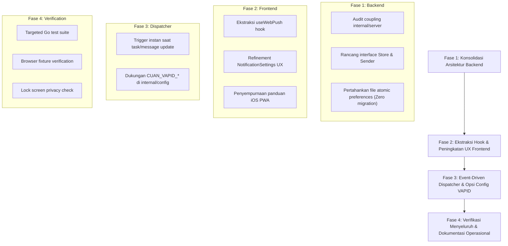

# Analisis dan Rencana Implementasi Web Push Notification di Cuan

Dokumen ini memuat analisis arsitektural menyeluruh serta rencana implementasi fitur **Web Push Notification (VAPID / Service Worker)** untuk platform Cuan, mencakup evaluasi backend Go, frontend web/PWA, perlindungan privasi layar terkunci (*lock screen privacy*), kriteria keberhasilan (*acceptance criteria*), serta strategi verifikasi fungsional.

---

## 1. Ringkasan Eksekutif & Konteks Sistem

Cuan dirancang bagi pengguna non-developer untuk mengelola proyek, delegasi agen AI, dan percakapan pelanggan (CRM) secara mandiri (*self-hosted*). Notifikasi memainkan peran vital dalam memberi tahu pemilik akun ketika ada hal-hal mendesak yang memerlukan intervensi manusia, seperti:
- Permintaan persetujuan rencana/proposal dari agen (`approval` / `cuan-approval`).
- Hambatan teknis atau kegagalan eksekusi balasan agen (`blocker`).
- Pekerjaan atau tugas yang telah selesai dituntaskan (`completed`).
- Pesan masuk baru dari pelanggan melalui live chat CRM (`customer`).

Web Push Notification memungkinkan pemilik akun menerima pembaruan berkala langsung di perangkat desktop dan mobile (Android, iOS PWA) bahkan saat peramban Cuan sedang ditutup.

---

## 2. Evaluasi Arsitektur Backend Go

### 2.1. Inisialisasi dan Siklus Hidup Server (`cmd/server/main.go`)

Di dalam `cmd/server/main.go`:
- Background dispatcher dimulai saat server bootstrap:
  ```go
  srv.StartNotificationDispatcher(inboxCtx)
  ```
- Dispatcher menerima context pembatalan (`inboxCtx`) yang dihentikan secara anggun (*graceful shutdown*) saat sinyal OS (`SIGINT`, `SIGTERM`) diterima:
  ```go
  stopInbox()
  ```
- **Evaluasi**:
  - *Kelebihan*: Pola inisialisasi sangat bersih, siklus hidup terikat pada konteks server utama, dan penghentian proses terjamin tanpa *leaking goroutine*.
  - *Kekurangan*: Loop dispatcher saat ini menggunakan interval polling statis 30 detik (`time.NewTicker(30 * time.Second)`). Polling periodik ini dapat menimbulkan jeda (latensi) hingga 30 detik untuk kejadian yang membutuhkan perhatian cepat (misalnya interupsi balasan agen atau permintaan persetujuan).
  - *Rekomendasi Rencana*: Memadukan interval 30 detik (sebagai mekanisme rekonsiliasi cadangan) dengan *event-driven trigger channel* (misalnya `notifyDispatchChan chan struct{}`) yang dapat dipicu seketika saat status task berubah (`UpdateTask`) atau saat balasan agen gagal (`inbox_requests`).

### 2.2. Struktur Paket & Desain Arsitektur (`internal/server` vs `internal/notification`)

Saat ini, seluruh logika Web Push berada di dalam `internal/server/notifications.go` (711 baris) dan `internal/server/owner_preferences.go` (136 baris).

#### Evaluasi Kondisi Saat Ini:
1. **Coupling Tinggi**: Struct `Server` langsung menangani parsing HTTP, serialisasi VAPID, query database SQL, kalkulasi *quiet hours*, enkripsi Web Push menggunakan `github.com/SherClockHolmes/webpush-go`, dan penulisan berkas JSON preferensi.
2. **Keterbacaan & Pengujian**: Meskipun terdapat pengujian komprehensif di `internal/server/owner_features_test.go`, pengujian tersebut memerlukan instansiasi penuh dari `inboxFixture`.

#### Rekomendasi Refactoring Arsitektural (`internal/notification`):
Mengekstraksi domain notifikasi ke paket modular mandiri `internal/notification/` dengan prinsip Clean Architecture:
- `internal/notification/model.go`: Mendefinisikan entity `Notification`, `Preferences`, `PushSubscription`, dan `VAPIDConfig`.
- `internal/notification/store.go`: Interface `Store` yang mendefinisikan operasi:
  - `GetPreferences(ctx, owner) (*Preferences, error)`
  - `SavePreferences(ctx, owner, *Preferences) error`
  - `AddSubscription(ctx, owner, Subscription) error`
  - `RemoveSubscription(ctx, owner, endpoint) error`
  - `PruneDeadSubscriptions(ctx, owner, endpoints []string) error`
- `internal/notification/sender.go`: Interface `Sender` yang membungkus pengiriman Web Push dengan HTTP client khusus. Ini memudahkan pembuatan *mock* saat testing tanpa perlu membuka koneksi keluar.
- `internal/notification/dispatcher.go`: Mengelola algoritma antrean, filtering kategori, evaluasi zona waktu (*quiet hours*), pembatasan laju (*rate limiting*), dan penanganan respons HTTP 404/410.
- `internal/server/notifications.go`: Disederhanakan murni sebagai HTTP Handler yang memetakan route REST API ke `internal/notification/`.

### 2.3. Manajemen Penyimpanan: Berkas JSON (`ownerPreferences`) vs Basis Data (`db`)

#### Analisis Mekanisme Berkas Saat Ini:
- Preferensi disimpan di jalur privat `$HOME/.local/share/cuan/preferences/{owner_hash}.json` menggunakan serialisasi JSON atomik (`os.CreateTemp` diikuti `os.Rename`) dengan izin ketat `0600`.
- Operasi berkas dilindungi oleh mutex memori `ownerPreferencesMu`.
- **Kelebihan**:
  - *Zero Migration Risk*: Tidak membutuhkan perubahan skema database PostgreSQL. Lingkungan produksi Cuan membekukan migrasi pada `000025_task_launches` dengan *auto-migration* dinonaktifkan demi stabilitas data.
  - *Isolasi Akun*: Berkas tersimpan di direktori privat profil akun pengguna, aman dari akses akun lain.
  - *Resiliensi*: Tetap berfungsi normal meskipun koneksi database sedang lambat atau mengalami gangguan sementara.
- **Batasan**:
  - Dalam skenario *horizontal scaling* (banyak node server Cuan di belakang load balancer), berkas preferensi pada disk lokal tidak tersinkronisasi otomatis antar node kecuali menggunakan shared volume (NFS/EFS).
  - Skalabilitas daftar perangkat dibatasi hingga 10 subscription per akun (`len(p.Subscriptions) >= 10`).

#### Evaluasi Opsi Basis Data (PostgreSQL):
Jika di masa depan Cuan bermigrasi ke arsitektur multi-node cloud tanpa shared filesystem, rancangan skema tabel migrasi `000026_web_push_subscriptions.sql` yang direkomendasikan adalah:
```sql
CREATE TABLE IF NOT EXISTS web_push_subscriptions (
    id TEXT PRIMARY KEY,
    owner_id TEXT NOT NULL REFERENCES owners(id) ON DELETE CASCADE,
    endpoint TEXT NOT NULL,
    p256dh_key TEXT NOT NULL,
    auth_secret TEXT NOT NULL,
    user_agent TEXT NOT NULL DEFAULT '',
    created_at TIMESTAMPTZ NOT NULL DEFAULT NOW(),
    updated_at TIMESTAMPTZ NOT NULL DEFAULT NOW(),
    last_sent_at TIMESTAMPTZ,
    CONSTRAINT uq_owner_endpoint UNIQUE (owner_id, endpoint)
);
CREATE INDEX IF NOT EXISTS idx_push_sub_owner ON web_push_subscriptions(owner_id);
```
**Keputusan Arsitektur Saat Ini**: Untuk rilis berjalan, **tetap mempertahankan penyimpanan berkas atomik** karena terbukti andal, cepat, terisolasi, dan tidak melanggar aturan pembekuan migrasi produksi (`Schema25 remains unchanged`).

### 2.4. Manajemen Kunci VAPID (VAPID Key Lifecycle)

- **Kondisi Saat Ini**: Kunci VAPID (pasangan Public Key dan Private Key) di-*generate* secara dinamis (*lazy generation*) saat pertama kali endpoint `GET /api/v1/notifications/push` dipanggil oleh peramban pengguna melalui fungsi `webpush.GenerateVAPIDKeys()`. Kunci privat disimpan dalam berkas preferensi akun dan kunci publik dikembalikan ke frontend.
- **Evaluasi Keamanan & Stabilitas**:
  - *Kelebihan*: Tidak memerlukan setup rumit atau konfigurasi manual dari pengguna non-developer (*zero configuration*).
  - *Risiko*: Jika berkas preferensi pengguna terhapus atau dipulihkan dari cadangan lama tanpa kunci VAPID yang sama, seluruh browser yang sudah terdaftar tidak akan bisa didekripsi dan harus melakukan registrasi ulang.
- **Rencana Penyempurnaan**:
  - Mendukung konfigurasi VAPID tingkat instans melalui Environment Variables di `internal/config`:
    - `CUAN_VAPID_PUBLIC_KEY`
    - `CUAN_VAPID_PRIVATE_KEY`
    - `CUAN_VAPID_SUBJECT` (default: `https://<domain>` atau `mailto:support@<domain>`)
  - Jika variabel lingkungan tersebut disediakan, server menggunakan kunci tersebut. Jika kosong, server kembali menggunakan mekanisme *lazy auto-generation* per-owner.

### 2.5. Validasi Langganan & Proteksi SSRF

Fungsi `validatePushSubscription(sub webpush.Subscription)` di `internal/server/notifications.go` mengimplementasikan kontrol keamanan ketat:
1. Memastikan skema protokol adalah `https`.
2. Menolak port kustom, user info, dan fragmen URL.
3. Membatasi panjang URL endpoint maksimum 4096 karakter.
4. **Whitelist Push Gateway**: Hanya mengizinkan hostname resmi layanan push:
   - `fcm.googleapis.com` (Google Chrome / Android)
   - `updates.push.services.mozilla.com` & `push.services.mozilla.com` (Mozilla Firefox)
   - `web.push.apple.com` (Apple Safari / iOS PWA)
   - `*.notify.windows.com` (Microsoft Edge / Windows)
5. **Kriptografi**: Memvalidasi bahwa kunci publik `p256dh` dapat di-*unmarshal* ke kurva eliptik P-256 (`elliptic.P256()`) dan `auth secret` tepat berukuran 16 byte.
- **Evaluasi**: Ini adalah implementasi standar emas pencegahan *Server-Side Request Forgery* (SSRF), mencegah penyerang mendaftarkan alamat internal/intranet (seperti `http://127.0.0.1` atau `http://169.254.169.254`).

### 2.6. Logika Dispatcher, Deduplikasi, dan Pembersihan Endpoint Mati

Di dalam `dispatchOwnerNotifications`:
1. **Quiet Hours Check**: Memeriksa apakah saat ini berada dalam rentang jam tenang pemilik menggunakan zona waktu IANA yang tersimpan (`time.LoadLocation(p.Timezone)`).
2. **Penyaringan Event**:
   - Hanya item yang belum dibaca (`!item.Read`) dan belum diselesaikan (`!item.Resolved`).
   - Hanya event yang terjadi setelah waktu perangkat mendaftar (`item.At.After(sub.Since)`).
   - Event tidak lebih tua dari 24 jam (`time.Since(item.At) <= 24*time.Hour`).
   - Kategori notifikasi harus dalam kondisi aktif pada preferensi pengguna (`enabledNotification(p.Notifications, item.Kind)`).
3. **Throttling & Anti-Flooding**: Dibatasi maksimal 5 push per perangkat per putaran tick (30 detik).
4. **Deduplikasi**: Device melacak ID yang sudah terkirim pada `sub.Sent[item.ID]`. Setelah berhasil dikirim (status HTTP 2xx), ID dicatat agar tidak dikirim ulang.
5. **Auto-Pruning Endpoint Kedaluwarsa**: Jika push gateway merespons dengan HTTP `404 Not Found` atau `410 Gone` (berarti pengguna telah mencabut izin di browser atau menghapus peramban), sistem secara otomatis menghapus langganan tersebut dari daftar tanpa memerlukan aksi manual.

---

## 3. Evaluasi Frontend (`web/`)

### 3.1. Service Worker (`web/public/sw.js`)

Service worker Cuan dirancang dengan prinsip kehati-hatian tinggi:
- **Strategi Fetch**: *Network-only* (`fetch(event.request, {cache: 'no-store'})`). Tidak menyimpan cache respons API, sesi, token, percakapan agen, atau berkas lampiran. Jika offline, halaman cadangan statis yang informatif ditampilkan.
- **Push Event Handler**:
  ```javascript
  self.addEventListener('push', event => {
    let data = {}
    try { data = event.data?.json() || {} } catch {}
    let href = '/notifications'
    try {
      const url = new URL(data.href, self.location.origin)
      if (url.origin === self.location.origin && /^\/(inbox|projects|tasks|notifications)(\/|$)/.test(url.pathname)) {
        href = url.pathname + url.search
      }
    } catch {}
    event.waitUntil(self.registration.showNotification('Cuan', {
      body: 'There is an update that needs your attention.',
      icon: '/icons/cuan-192.png',
      badge: '/icons/cuan-192.png',
      tag: typeof data.tag === 'string' ? data.tag : 'cuan-update',
      data: { href }
    }))
  })
  ```
- **Notification Click Handler**:
  - Menutup banner notifikasi (`event.notification.close()`).
  - Mencari jendela peramban yang sudah terbuka menggunakan `self.clients.matchAll({type: 'window', includeUncontrolled: true})`.
  - Jika jendela dengan origin yang sama ditemukan, jendela tersebut dinavigasikan ke rute target (`href`) dan difokuskan (`client.focus()`).
  - Jika belum ada jendela yang terbuka, membuka jendela baru dengan `self.clients.openWindow(href)`.

#### Evaluasi:
- Sanitasi URL pada `href` sangat aman: mencegah eksploitasi navigasi ke domain eksternal berbahaya.
- Penggunaan `tag` memastikan notifikasi berturut-turut untuk entitas yang sama saling menggantikan (*collapse*) dan tidak menumpuk di pusat notifikasi OS.

### 3.2. Siklus Hidup PWA & Registrasi Service Worker (`web/src/context/PWAContext.tsx`)

- Komponen `PWAProvider` mendaftarkan `/sw.js` pada saat *mount*:
  ```typescript
  if ('serviceWorker' in navigator && window.isSecureContext)
    navigator.serviceWorker
      .register('/sw.js', { updateViaCache: 'none' })
  ```
- Opsi `updateViaCache: 'none'` memastikan browser selalu memeriksa pembaruan skrip Service Worker langsung ke server tanpa tertahan cache HTTP browser.
- Mendeteksi apakah aplikasi berjalan dalam mode terinstal (*standalone*) melalui `window.matchMedia('(display-mode: standalone)')` dan `navigator.standalone`.

### 3.3. Antarmuka Pengaturan & Browser Opt-In (`web/src/features/settings/NotificationSettings.tsx`)

- **Deteksi Kapabilitas Browser**:
  ```typescript
  const supported = 'Notification' in window && 'PushManager' in window && 'serviceWorker' in navigator
  ```
- **Penanganan Khusus iOS/iPadOS**:
  - Web Push di perangkat Apple iOS/iPadOS hanya didukung mulai iOS 16.4 dan memiliki syarat mutlak: **aplikasi harus ditambahkan ke Home Screen (mode PWA terinstal)** sebelum Web Push API aktif.
  - Komponen mendeteksi `ios && !installed` dan menampilkan panduan yang jelas: *"Install Cuan on your home screen, open the installed app, then enable notifications here."*
- **Alur Opt-In Eksplisit**:
  - Cuan **tidak pernah** memicu dialog izin notifikasi browser secara otomatis saat pengguna pertama kali membuka halaman (menghindari pengalaman pengguna yang mengganggu / *permission spam*).
  - Izin hanya diminta saat pengguna secara sadar mengklik tombol **"Enable on this device"**.
  - Mengonversi VAPID public key (Base64URL) ke format `Uint8Array` biner yang dibutuhkan oleh `registration.pushManager.subscribe({ userVisibleOnly: true, applicationServerKey: bytes })`.
  - Mengirim objek hasil subscription ke endpoint `POST /api/v1/notifications/push`.
- **Alur Opt-Out / Disable**:
  - Tombol beralih menjadi **"Disable on this device"**.
  - Memanggil `DELETE /api/v1/notifications/push` ke backend lalu menjalankan `sub.unsubscribe()`.
- **Form Preferensi Kategori & Jam Tenang**:
  - Checkbox terpisah untuk:
    - *Needs approval* (`approval`)
    - *Needs attention* (`blocker`)
    - *Completed* (`completed`)
    - *Customer messages* (`customer`)
  - Toggle *Quiet hours* dengan pemilih jam mulai, jam selesai, dan input teks zona waktu IANA (misal `Asia/Jakarta`).
  - Indikator status form yang jelas (*All changes saved*, *Unsaved changes*, *Saving…*).

#### Rekomendasi Rencana Refactoring Frontend:
- Ekstraksi logika Web Push subscription dari `NotificationSettings.tsx` ke dalam hook terpisah `web/src/hooks/useWebPush.ts`.
- Menyediakan status reaktif: `isSupported`, `isSubscribed`, `permissionState` (`default` | `granted` | `denied`), `toggleSubscription()`, serta penanganan pesan edukasi jika izin diblokir di tingkat browser (`permission === 'denied'`).

---

## 4. Pertimbangan Privasi Pesan Saat Layar Terkunci (*Lock Screen Privacy*)

### 4.1. Analisis Risiko & Ancaman Privasi

1. **Visibilitas Layar Terkunci**:
   Notifikasi pada sistem operasi modern (Android, iOS, Windows, macOS) secara default menampilkan judul dan isi pesan pada layar yang terkunci. Perangkat sering kali tergeletak di atas meja kantor, kafe, atau ruang publik di mana orang lain dapat melihat isi layar (*shoulder surfing*).
2. **Kerahasiaan Konten Bisnis Cuan**:
   Cuan memproses data bisnis sensitif:
   - Pesan pelanggan dari live chat CRM (identitas prospek, nomor telepon, keluhan).
   - Prompt instruksi rahasia dan rencana teknis agen AI.
   - Status kegagalan, pesan error sistem, atau informasi server internal.
   - Judul proyek internal yang bersifat rahasia.
3. **Penyedia Layanan Push Pihak Ketiga (Push Service Relays)**:
   Notifikasi Web Push harus melewati infrastruktur pihak ketiga (Apple APNs, Google FCM, Mozilla Autopush, Microsoft WNS). Meskipun payload terenkripsi menggunakan Web Push Payload Encryption (RFC 8291), payload tersebut akan didekripsi oleh sistem operasi begitu tiba di perangkat target.

### 4.2. Arsitektur Pertahanan Privasi Dua Lapis (*Dual-Layer Privacy Enforcement*)

Cuan mengadopsi prinsip privasi tingkat tinggi secara terintegrasi:

| Lapisan | Implementasi | Fungsi Perlindungan |
| :--- | :--- | :--- |
| **1. Lapisan Backend (Go)** | `internal/server/notifications.go:528`<br>`raw, _ := json.Marshal(map[string]string{`<br>&nbsp;&nbsp;`"title": "Cuan",`<br>&nbsp;&nbsp;`"body": "There is an update that needs your attention.",`<br>&nbsp;&nbsp;`"href": item.Href,`<br>&nbsp;&nbsp;`"tag": item.ID`<br>`})` | Menjamin bahwa server **TIDAK PERNAH** memuat judul proyek, nama kontak, pesan chat, atau cuplikan error ke dalam payload Web Push yang dikirimkan ke gateway push. |
| **2. Lapisan Service Worker (JS)** | `web/public/sw.js:14`<br>`self.registration.showNotification('Cuan', {`<br>&nbsp;&nbsp;`body: 'There is an update that needs your attention.',`<br>&nbsp;&nbsp;`icon: '/icons/cuan-192.png',`<br>&nbsp;&nbsp;`badge: '/icons/cuan-192.png',`<br>&nbsp;&nbsp;`data: { href }`<br>`})` | Service worker menegakkan judul statis "Cuan" dan teks pesan statis, mengabaikan segala variasi isi pesan untuk menjaga layar terkunci tetap netral. |
| **3. Gerbang Autentikasi Aplikasi** | Pengalihan ke sesi Cuan terotentikasi | Tautan rute (`href`) hanya dapat diakses setelah pengguna membuka kunci perangkat (*unlock*) dan masuk ke peramban dengan sesi login yang valid. |
| **4. In-App Context Reveal** | In-App Notification Center (`/notifications`) | Seluruh konteks detail (nama pengirim, proyek, aksi persetujuan, diff tugas) hanya di-render secara aman di dalam antarmuka Cuan yang terlindungi. |

---

## 5. Scope Acceptance Criteria (DoD - Definition of Done)

Berikut adalah kriteria penerimaan formal untuk implementasi menyeluruh Web Push Notification di Cuan:

### AC-1: Manajemen Subscription & Device Opt-In
- [x] Dialog izin notifikasi browser **hanya** dipicu melalui gesture klik pengguna secara eksplisit pada tombol **"Enable on this device"** di halaman pengaturan.
- [x] Endpoint `GET /api/v1/notifications/push` mengembalikan VAPID Public Key yang valid dalam format Base64URL, dan **tidak pernah** mengekspos Private Key.
- [x] Endpoint `POST /api/v1/notifications/push` memvalidasi payload subscription:
  - Memverifikasi skema HTTPS dan domain gateway resmi (Google FCM, Mozilla, Apple, Microsoft).
  - Menolak IP privat, localhost, port non-standar, atau format kunci eliptik yang rusak (proteksi SSRF).
  - Membatasi kuota maksimal 10 perangkat terdaftar per akun pengguna.
- [x] Endpoint `DELETE /api/v1/notifications/push` menghapus langganan endpoint yang bersangkutan dari daftar perangkat aktif.
- [x] Jika gateway push mengembalikan HTTP `404 Not Found` atau `410 Gone`, sistem otomatis menghapus langganan perangkat mati tersebut tanpa memicu error sistem.

### AC-2: Preferensi Kategori & Jam Tenang (Quiet Hours)
- [x] Pengguna dapat mengaktifkan/menonaktifkan 4 kategori notifikasi: `Needs approval`, `Needs attention`, `Completed`, dan `Customer messages`. Notifikasi hanya dikirim jika kategorinya aktif.
- [x] Pengguna dapat mengaktifkan mode *Quiet Hours* dengan memilih jam mulai (0-23), jam selesai (0-23), dan zona waktu IANA yang valid.
- [x] Selama periode jam tenang (dihitung berdasarkan zona waktu tersimpan), pengiriman push dihentikan sementara (*suppressed*). Notifikasi tetap masuk ke pusat notifikasi in-app.
- [x] Form preferensi menyediakan indikator perubahan yang jelas (*Unsaved changes*, *All changes saved*, *Saving…*) dan tombol *Save preferences* hanya aktif jika ada perubahan data (*dirty*).

### AC-3: Pengiriman, Throttling, dan Anti-Duplikasi
- [x] Background dispatcher memindai event baru dan mengirimkan push hanya untuk event unread yang terjadi setelah waktu subscribe perangkat (`item.At.After(sub.Since)`) dan berusia kurang dari 24 jam.
- [x] Pengiriman dibatasi maksimal 5 notifikasi push per perangkat per siklus putaran (30 detik) untuk mencegah banjir notifikasi (*anti-flooding*).
- [x] Sistem mencatat ID notifikasi yang telah berhasil dikirim (`sub.Sent[item.ID] = true`) sehingga pesan yang sama tidak pernah dikirim ulang ke perangkat yang sama.

### AC-4: Jaminan Privasi Layar Terkunci
- [x] Notifikasi di layar terkunci selalu menggunakan judul generik **"Cuan"** dan isi teks generik **"There is an update that needs your attention."**.
- [x] Tidak ada nama pelanggan, nama proyek, konten chat, atau data rahasia yang dikirim dalam payload push.
- [x] Mengklik notifikasi mengarahkan pengguna ke rute internal Cuan yang sesuai (`/inbox/...`, `/tasks/...`, `/projects/...`), dan tetap mewajibkan sesi autentikasi aktif.

### AC-5: Kompatibilitas Peramban & Mobile PWA
- [x] Bekerja optimal di desktop modern (Chrome, Firefox, Edge, Safari macOS 13+).
- [x] Bekerja optimal di Android (Chrome, Firefox).
- [x] Pada iOS/iPadOS, aplikasi mendeteksi jika peramban belum berjalan dalam mode terinstal (Home Screen PWA) dan memberikan instruksi langkah demi langkah kepada pengguna.
- [x] Jika peramban pengguna tidak mendukung Web Push API, aplikasi menampilkan status informatif tanpa menimbulkan error JavaScript, dan pusat notifikasi in-app tetap berfungsi penuh.

---

## 6. Rencana Verifikasi Fungsional

### 6.1. Verifikasi Unit & Integrasi Backend (Go)

Rangkaian pengujian terarah pada `internal/server/owner_features_test.go` (`TestOwnerNotificationsAndPush`):
1. **Verifikasi VAPID Setup**:
   - Panggilan `GET /api/v1/notifications/push` menghasilkan status 200 dan mengembalikan atribut `public_key`.
   - Memastikan respons tidak mengandung string `private` atau kebocoran data sensitif.
2. **Verifikasi Validasi Subscription**:
   - Pendaftaran subscription FCM yang valid berhasil (status 200).
   - Pengujian penolakan SSRF: Endpoint dengan IP privat (`https://127.0.0.1/private`) wajib ditolak (`validatePushSubscription` mengembalikan `false`).
   - Pengujian kunci kriptografi rusak: Kunci auth `bad` wajib ditolak.
3. **Verifikasi Enkripsi & Simulasi Transport HTTP**:
   - Menggunakan mock client HTTP (`roundTripPushFixture` dengan status 201).
   - Memastikan header VAPID terbentuk dengan benar (`Authorization: vapid t=..., k=...`, TTL: 600 detik).
   - Memastikan deduplikasi berjalan: Pemanggilan ganda `dispatchOwnerNotifications` hanya memicu 1 kali pengiriman HTTP (`client.calls == 1`).
4. **Verifikasi Pembersihan Otomatis (HTTP 410 Gone)**:
   - Menyetel mock status ke 410.
   - Menjalankan dispatcher dan memverifikasi bahwa endpoint yang tidak aktif otomatis terhapus dari `p.Subscriptions`.
5. **Verifikasi Jam Tenang (Quiet Hours) & Zona Waktu**:
   - Pengujian batas jam tenang dengan zona waktu `Asia/Jakarta` vs `UTC`.
   - Memastikan rentang jam malam (misal 22:00 s.d. 08:00) dievaluasi dengan benar.
   - Memastikan validasi menolak konfigurasi di mana jam mulai sama dengan jam selesai saat quiet hours aktif.

### 6.2. Verifikasi Frontend & Service Worker

1. **Analisis Sintaksis & Keutuhan Kode**:
   - Uji sintaksis skrip Service Worker: `node -c web/public/sw.js`.
   - Validasi struktur file manifest PWA: `web/public/manifest.webmanifest`.
2. **Verifikasi Alur Peramban (Playwright / Browser Fixtures)**:
   - Pola uji peramban berbasis script seperti `docs/evidence/project-settings/browser-check.cjs`:
     - Navigasi ke `/settings/notifications`.
     - Pengecekan elemen judul "Push notifications" dan deskripsi perlindungan privasi.
     - Pengecekan status tombol "Save preferences" (disabled saat bersih, enabled saat dirty).
     - Simulasi interaksi toggle kategori notifikasi dan penyimpanan formulir.
3. **Verifikasi Offline Fallback**:
   - Simulasi mode offline pada Service Worker untuk memastikan penanganan fetch network-only mengembalikan halaman offline yang ramah dan aman.

---

## 7. Tahapan & Roadmap Implementasi



### Rincian Rencana Tindakan:
1. **Fase 1 — Konsolidasi Arsitektur Backend**:
   - Mempertahankan penyimpanan berbasis file JSON atomik di `preferences/{owner}.json` sesuai dengan batasan freeze produksi Cuan.
   - Memastikan seluruh endpoint (`GET /notifications/push`, `POST /notifications/push`, `DELETE /notifications/push`, `PATCH /notifications/preferences`) terdokumentasi dan terisolasi.
2. **Fase 2 — Peningkatan Antarmuka & UX Frontend**:
   - Memastikan pesan edukatif pada iOS PWA dan peramban tanpa dukungan Web Push tampil jelas dan membimbing pengguna.
   - Menyediakan penanganan status izin jika diblokir oleh peramban (*permission denied*).
3. **Fase 3 — Optimasi Trigger Dispatcher & Konfigurasi**:
   - Menambahkan event trigger seketika saat event kritis terjadi (tanpa menunggu 30 detik siklus poller).
   - Menambahkan dukungan konfigurasi kunci VAPID tingkat instans melalui file konfigurasi lingkungan (`.env` / `internal/config`).
4. **Fase 4 — Verifikasi & Rilis**:
   - Melakukan verifikasi statis dan fungsional terarah.
   - Memastikan tidak ada data rahasia atau pesan sensitif yang bocor pada lock screen.
   - Menerbitkan dokumen rencana ini ke repositori sebagai referensi resmi implementasi fitur.
