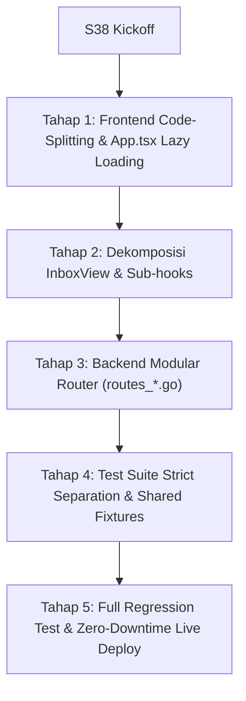

# Cuan Sprint 38 — Holistic Architecture Modernization: Frontend Code-Splitting, Modular Backend Routing, & Test Suite Streamlining

## Rekomendasi untuk PO (diajukan SM)

**Rekomendasi:** Approve scope S38 — memodernisasi arsitektur Cuan secara menyeluruh tanpa mengubah fungsionalitas bagi pengguna non-developer (*zero breaking changes*). Sprint ini mencakup 3 pilar: (1) pemecahan bundle frontend monolitik via *route-level code-splitting* (`React.lazy`) dan dekomposisi `InboxView`, (2) refactoring modular router backend untuk memecah `internal/server/server.go` (2.911 baris) menjadi domain routing file terpisah, dan (3) penataan ulang test suite dengan pemisahan tegas antara fast unit tests (< 5s) dan slow integration tests, serta shared test fixture package `internal/testutil`.

**Alasan:** Codebase Cuan telah berkembang pesat melewati 37 sprint berturut-turut. Pertumbuhan pesat ini meninggalkan hutang teknis berupa file raksasa (*god files*) di frontend dan backend yang memperlambat waktu muat browser, memicu warning build Vite (~1 MB chunk), dan memperpanjang durasi siklus pengujian. Melalui S38, arsitektur dibuat modular, bersih, cepat, dan mudah dipelihara untuk sprint-sprint mendatang.

---

## Rincian Scope & Deliverables

### 1. S38.1 — Frontend Modernization & Code-Splitting
- **Route-Level Dynamic Imports**:
  - Terapkan `React.lazy()` dan `<Suspense>` pada [`web/src/App.tsx`](file:///home/dev/repos/cuan/web/src/App.tsx) untuk halaman-halaman berat: `StudioView`, `TaskBoardView`, `TaskSessionPage`, `TeamView`, `ContactsView`, dan `Settings`.
  - Mengurangi ukuran *initial JS bundle* dari ~1 MB menjadi < 250 KB (gzip), menghilangkan warning Vite chunk size, dan mempercepat load awal UI di perangkat mobile.
- **Dekomposisi Monolitik `InboxView.tsx` (1.827 baris)**:
  - Ekstraksi logika streaming obrolan dan manajemen pesan ke custom hooks terfokus: `useInboxStream.ts` dan `useInboxMessages.ts`.
  - Pisahkan sub-komponen modular untuk input obrolan (`InboxComposer.tsx`) dan daftar percakapan (`InboxMessageList.tsx`).
- **Modul File Preview Terisolasi**:
  - Refactor [`FilePreviewModal.tsx`](file:///home/dev/repos/cuan/web/src/components/dialogs/FilePreviewModal.tsx) (1.549 baris) menjadi modul handler terpisah per format file (kode sumber, gambar, markdown, PDF).

### 2. S38.2 — Backend Modular Routing & Clean Layering
- **Dekomposisi `internal/server/server.go` (2.911 baris)**:
  - Ekstraksi pendaftaran route HTTP ke router terpisah per domain:
    - `routes_tasks.go`: Task management, task attempts, logs, dan activity streams.
    - `routes_inbox.go`: Inbox messages, chat streaming, approvals, dan contact rooms.
    - `routes_agents.go`: Provider account pairing, CLI connections, dan runner protocols.
    - `routes_projects.go`: Project workspaces, git repos, modules, dan template instantiations.
  - Memangkas `server.go` menjadi file ramping (< 400 baris) yang murni fokus pada struktur `Server`, dependensi, dan startup/shutdown lifecycle.
- **Pembersihan Handler vs Service Layer**:
  - Memastikan seluruh mutasi data pada `chat_handlers.go` dan `agent_handlers.go` memanggil domain service (`task.Service`, `runner.Service`, `project.Service`) tanpa kueri SQL mentah langsung di layer HTTP.

### 3. S38.3 — Test Suite Streamlining & Acceleration
- **Pemisahan Strict Fast Unit Test vs Slow Integration Test**:
  - Unit test murni (validasi skema payload, sanitasi URL, parsing git branch, logika diskonto) dieksekusi cepat dalam < 5 detik.
  - Integration test yang memutar subprocess PTY terminal, supervisor lock, atau git clone lokal dialokasikan ke pengujian terisolasi (dapat diskip dengan `-short`).
- **Shared Test Utility Package (`internal/testutil`)**:
  - Menyatukan boilerplate test (dummy auth context, memory store instantiator, mock coordinator responses, clean workspace temporary dirs) ke dalam package `internal/testutil`.
  - Mengeliminasi duplikasi setup code pada file-file `_test.go`.

### 4. S38.4 — Verifikasi, DoD & Live Production Deployment
- 100% Unit & Integration Test backend lulus (`go test ./...`).
- 100% Frontend test suite lulus (`npm test --prefix web`).
- Build frontend Vite sukses tanpa chunk-size limit warnings.
- Deploy live production via `scripts/deploy.sh` terverifikasi healthy di `https://cuan.dojo.cc/healthz`.

---

## Rencana Tahapan Eksekusi

